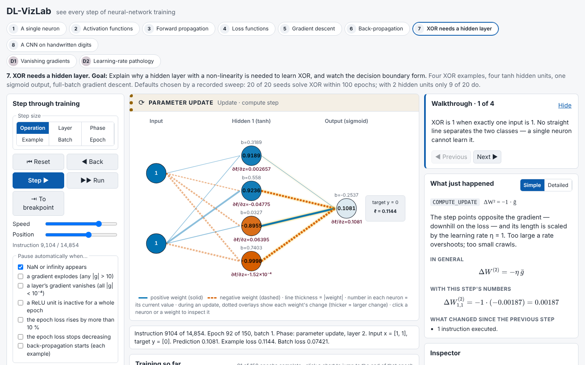
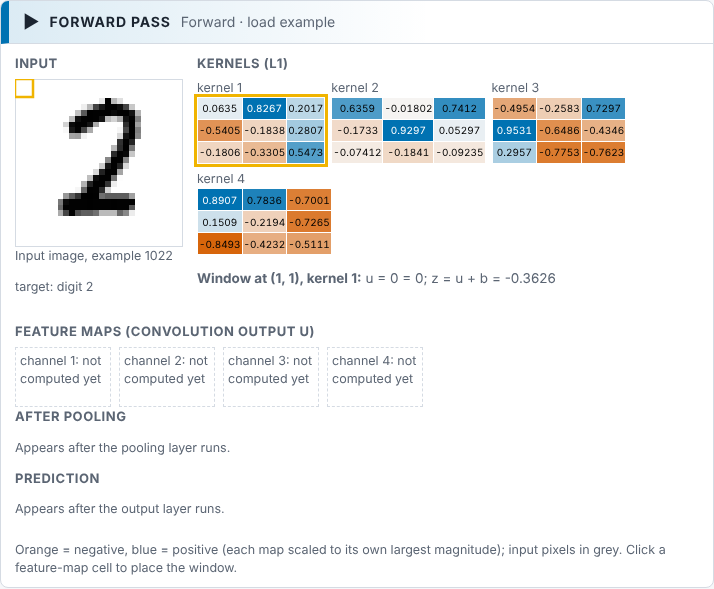
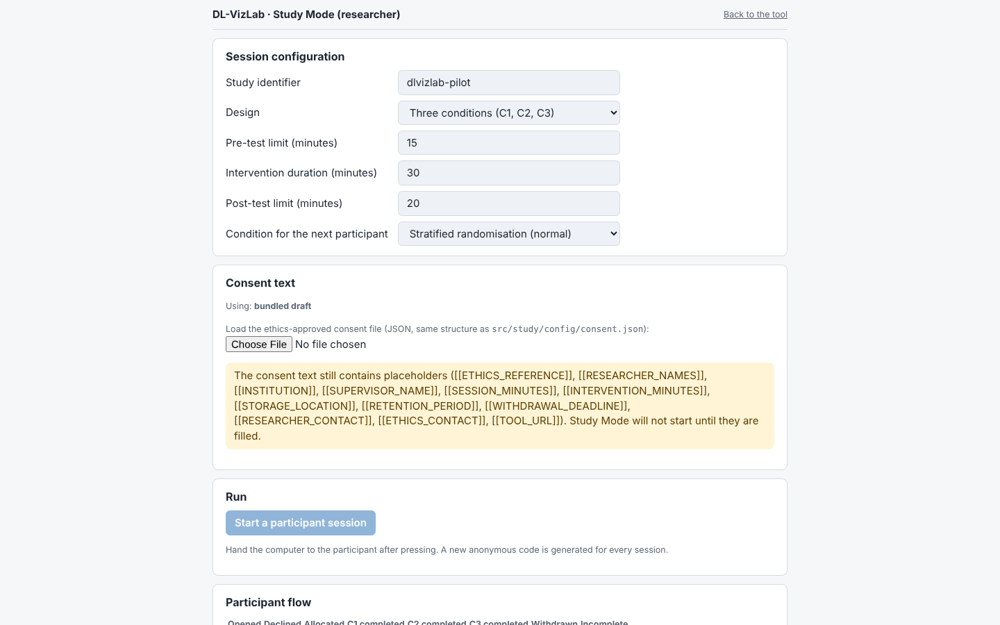

# DL-VizLab

A browser-only learning environment that makes neural-network **training** observable step by step. Every operation of a training run (forward pass, loss, each gradient of back-propagation, each parameter update) is recorded as an instruction of the **Neural Program Model (NPM)**, a formally specified, serializable, replayable intermediate representation. Learners step through a run at six granularities (operation, layer, phase, example, batch, epoch), forwards and backwards. Each instruction is explained with its general formula, the same formula with that step's numbers, and a sentence.



**Live demo:** published by `.github/workflows/pages.yml` to GitHub Pages once Pages is enabled for the repository (Settings → Pages → Source: GitHub Actions); the address is then `https://2govindhr2.github.io/viz/`. Study Mode is at the same address with `#study` appended.

## What is in it

- **Engine** (`src/core`): an own float64 tensor and reverse-mode autodiff core, dense, conv2d, pooling and flatten layers, MSE/BCE/CCE losses, SGD and momentum. It is gradient-checked, and agrees with TensorFlow.js on every loss and every parameter after every step (TF.js is used in tests only). Runs are bit-for-bit deterministic from a seed.
- **Neural Program Model** (`src/core/npm`, `docs/NPM-SPEC.md`): 30 instruction kinds, a grammar, a JSON schema, lossless serialisation, checkpoint-and-recompute storage for long runs, breakpoints, and two independent reference tools (`tools/npm-verify.mjs`, `tools/npm-replay.mjs`).
- **Two paths, one engine** (`docs/DESIGN-SCOPE.md`): a guided novice path is the default. Each experiment opens with a question and one control, asks for a prediction before the run, and reveals what happened. Step sizes and vocabulary unlock with the curriculum, and detail is revealed in place. Expert mode (header button, or `?mode=expert`) is the full workbench below; switching keeps the position. Experiments 1, 5 and 6 have purpose-built novice screens so far.
- **Three synchronised views** (expert mode):
  - A, execution: the network, or for CNNs the kernels, sliding window and feature maps.
  - B, training: loss and accuracy curves, gradient magnitude by layer, histograms, decision boundary.
  - C, structure: layers, shapes and editable architecture.

  An explanation module and a step-by-step inspector complement the views.
- **Curriculum** (`src/experiments`): ten experiments, from a single neuron to a CNN on reduced MNIST (97 % held-out accuracy in about 8 s in the browser), plus two diagnostics (vanishing gradients, learning-rate pathology). Each has a guided walkthrough and a self-check.
- **Pathology detection** (`docs/PATHOLOGIES.md`): NaN/∞, exploding and vanishing gradients, dead ReLUs and learning-rate divergence. Each stops the run at the instruction that caused it.
- **Figure export** (`src/export`): every view as vector SVG/PDF in colour, greyscale or high contrast, with a CSV of the plotted numbers. A batch tool produces the standard figure set from any trace.
- **Study Mode** (`src/study`, `docs/STUDY-PROTOCOL.md`): runs a three-condition learning study (static material, TensorFlow Playground exercise, DL-VizLab) end to end. It covers consent, randomisation, timed tests, SUS, NASA-TLX, telemetry and a one-click CSV export, with no personal data.
- **Analysis pipeline** (`analysis/`): ANCOVA, or Kruskal–Wallis when its assumptions fail, plus effect sizes, reliability, gains by concept and Bloom level, and power. It is validated on simulated data at n = 30/60/120.

| Convolution view (experiment 8) | Study Mode researcher screen |
|---|---|
|  |  |

## Build and run

Requirements: Node 22, and Python 3.13 for the analysis pipeline.

```sh
npm ci
npm run dev            # app at http://localhost:5173 (Study Mode: /#study)
npm run build          # static site in dist/ — no server, no network calls at run time
npm test               # unit, gradcheck, TF.js parity, determinism, Study Mode, figures
npm run test:e2e       # Playwright (Chromium), including the WCAG audit
pip install -r analysis/requirements.txt
python3 -m unittest analysis/test_analysis.py && python3 analysis/validate.py
```

Regenerating evidence: `npm run measure` (performance), `npm run report` (VALIDATION-REPORT, TRACE-STATISTICS, NPM-SPEC tables), `npm run figures` (publication figures), `npm run figures:batch -- --experiment xor-mlp out/ --mode all` (standard figure set from any experiment or trace file), `npm run slides` (C1 study material).

## Architecture

```
src/core/       tensor, autodiff, layers, losses, optimisers, seeded RNG  — no DOM, no I/O
  npm/          IR, emitter, schema, serialisation, trace store, navigation, breakpoints, pathologies
  engine/       training session, datasets, worker protocol and host
src/explain/    explainer registry: formulas (KaTeX), substituted numbers, sentences, "what changed"
src/views/      execution (A), training (B), structure (C), experiment panels
src/experiments/ curriculum definitions, progress, reduced MNIST
src/export/     figure builders, print modes, CSV and ZIP writers
src/study/      Study Mode: instruments, randomisation, telemetry, export, screens
src/ui/         app shell, Zustand store, Web Worker client
```

All training runs in a Web Worker. The worker generates the whole trace, keeps batch checkpoints and an LRU cache of instructions, and answers navigation requests. The UI renders the state reconstructed at the cursor and never computes anything itself. Decisions are recorded in `docs/DECISIONS.md` (ADR-001 to ADR-031).

## Extending

**Add an experiment.** Add an entry to `EXPERIMENTS` in `src/experiments/registry.ts` with:
- a training configuration and a dataset;
- editable parameters, suggested breakpoints and a default step size;
- walkthrough steps (each with an optional "Show me" action) and self-check questions.

Add a test in `tests/unit/experiments.test.ts` that trains it and checks the behaviour its objective claims. Then run `npm run slides` so the Study Mode C1 material includes it.

**Add an NPM instruction.** Follow the LayerNorm tutorial in `docs/NPM-SPEC.md` §7.2 (worked code in `examples/layernorm.ts`):
1. Register the differentiable op with `registerOp` (`src/core/autodiff`).
2. Declare the instruction kind and how the op maps to it with `registerInstructionKind` and `registerOpMapping` (`src/core/npm/kinds.ts`). Regenerate the JSON schema with `npm run schema`.
3. Register an explainer with `registerExplainer` (`src/explain/registry.ts`) and a visual mapping with `registerVisualMapping` (`src/views/registry.ts`).
4. Add it to the gradient checks and, if TF.js has the op, to the parity suite.

## Documentation

`docs/`: AUDIT, DECISIONS, PROGRESS, NPM-SPEC, VALIDATION-REPORT, TRACE-STATISTICS, PATHOLOGIES, ACCESSIBILITY, DATASETS, COMPARISON-MATRIX, TASK-ANALYSIS, CURRICULUM-COVERAGE, STUDY-PROTOCOL, DATA-DICTIONARY, RESULTS-SKELETON (simulated data only), PAPER-NOTES, DEFINITION-OF-DONE, LIMITATIONS, KNOWN-GAPS, FUTURE-WORK.

## Licence and citation

MIT (see `LICENSE`); the reduced MNIST subset is CC BY-SA 3.0 (see `docs/DATASETS.md`). If you use DL-VizLab, please cite it using `CITATION.cff`:

```bibtex
@software{dlvizlab_2026,
  title   = {DL-VizLab: an observable, replayable deep-learning training environment built on the Neural Program Model},
  author  = {Nair, Abhinav G and R, Govindh and Meenakshi and Agrahari, Swayam and Swaminathan, J},
  year    = {2026},
  version = {0.9.0},
  license = {MIT},
  url     = {https://github.com/2GOVINDHR2/viz}
}
```

An archival DOI is minted by Zenodo when a GitHub release is published with the Zenodo integration enabled (see `docs/PAPER-NOTES.md`, "Release").
